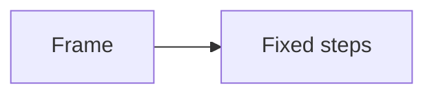

# Card: concept (C)

An idea of engines in general and Strata's choice. `time` ≤ 2 × the reading floor; `since` where common.md requires
it.

## Order

Headings other than the exact ones say what the section establishes ("Fixed steps make physics repeatable").

1. The problem as the reader meets it: a story, a picture or an experiment (Show). It may stand before the first
   heading.
2. The naive answer and where it breaks.
3. The idea: the mental model in one paragraph and one diagram, its terms named.
4. The approaches engines use: 2 to 5, each introduced by the flaw of the one before, ending with a table of cost,
   quality, complexity and who uses them, each with a source in Further reading.
5. Strata's choice and its reason (a `:::why` aside for a design decision), with a link to the internals page.
6. What Strata's choice cannot do, and what Strata does not do here, linking `appendix/not-in-strata`.
7. `## Common mistakes`: each mistake, its symptom, its fix. Ends the body.

At least one `:::example` stands before the strip (strips).

## Bottom strip (exact headings, in this order)

1. `## Summary`: one bullet per learn line, in order.
2. `## Check yourself`: 3–6 numbered questions, each with `:::answer{tests="<learn ids>"}`: multiple choice whose
   wrong options are the page's common mistakes (the answer says why each option is right or wrong), predict the
   output, short computations.
3. `## Exercises`: 1–4, from **Basic.** to **Hard.**, each with `:::answer[Worked solution]{tests="…"}` worked step by
   step. Kinds: predict then run, modify, Parsons problem (shuffled lines in a `text` fence), faded examples, design.
   At least one exercise is done, not only answered: its answer `:::answer[Worked solution]{tests="…" solution="…"}`
   names its file. On G or B before `make/first-script`, on G later, and on E before `basics/programming-1`: an editor
   task or a command, `tutorials/<page id>/exercise-<n>.tutorial.json` (its form: `tools/schemas/tutorial.schema.json`,
   as in `tutorials/start/install/exercise-2.tutorial.json`). On B later and on E from `basics/programming-1`:
   code, a sketch `sketches/<part>-<chapter>-<name>.cpp` shown in full in the answer, then its `output-of` fence; after
   `core/first-change`, also an engine change, `tutorials/<page id>/exercise-<n>.patch`. A page on several tracks meets
   each. A trace exercise's answer names the file and function, without `solution=`; it is not the done one.
4. `## Where it lives in Strata`: on track G or B the panels, menus, commands, components and settings; on track E
   only, the files, classes, tests, commands and settings. Every name is checked by names.
5. `## Further reading`.

## Skeleton

````md
<The problem, shown.>

## <Where the naive answer breaks>

## <The idea>



<What the diagram showed.>

## <How engines solve it>

| Approach | Cost | Quality | Complexity | Used by |
| --- | --- | --- | --- | --- |

:::example[<problem>]
…
:::

## <Strata's choice>

:::why[<question>]
…
:::

## What Strata's choice cannot do

## Common mistakes

## Summary

## Check yourself

## Exercises

## Where it lives in Strata

## Further reading
````
